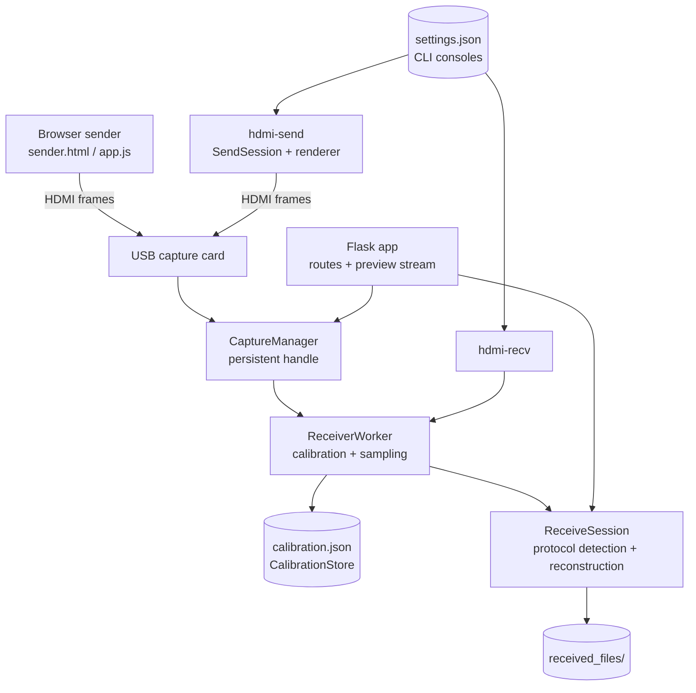

# Architecture

## Goal

The project is organized around a shared transfer engine, a single protocol manifest and thin interfaces. Protocol behavior belongs in shared modules rather than separate UI, CLI or web implementations.

## Layers

```text
src/
  domain/          Canonical protocol data
  application/     Send/receive sessions and events
  adapters/        Capture, storage and technical integrations
  interfaces/      CLI, Flask web interface and browser sender
  core/            Protocols, encoding, sampling and file handling
  sender/          Display detection and frame renderers
  receiver/        Capture source and video backends
  web/             Web entry point and static assets
```

## Responsibilities

| Layer | Responsibility | Keep out of this layer |
| --- | --- | --- |
| `domain` | Protocol manifest, immutable models, shared constants | I/O, capture, Flask, pygame, OpenCV |
| `application` | Session orchestration, events, progress, send/receive transitions | Direct hardware access, UI rendering |
| `adapters` | Persistent capture, device registry, storage and integrations | Protocol rules |
| `interfaces` | CLI commands, web routes, preview, sender HTML generation | Protocol state machines and decoding heuristics |

## Overview



## Sources of truth

- `hdmi_transfer.domain.protocol_manifest` defines profiles, magic values, header sizes and parameters exposed to the browser sender.
- `tools/build_sender_html.py` generates `sender.html` and `protocol.generated.js` from the manifest and browser sources. Do not edit the standalone HTML directly.
- `hdmi_transfer.application.send_session.SendSession` and `hdmi_transfer.application.receive_session.ReceiveSession` provide shared state machines. CLI and web interfaces use these services instead of duplicating behavior.
- `hdmi_transfer.domain.transfer_defaults` defines recommended interface defaults. Legacy wire-format defaults remain separate.

## Sending flow

1. The interface collects user options.
2. `SendSession` reads the payload, builds metadata and produces packets/frame events.
3. The selected renderer displays the frames.
4. The browser sender follows the same wire protocol through generated assets.

A folder or several files selected or dropped in the browser sender are packed
offline by `interfaces/browser_sender/archive.js` (deflate through
`CompressionStream` when it helps, stored otherwise, 65 535 entries max) into a
single `<folder>.zip` or `files.zip`. The archive then follows the normal
single-file path, so the receiver and the wire protocol are unchanged and the
result is received as one `.zip`.

## Receiving flow

1. `CaptureManager` opens or reuses a persistent capture handle.
2. `hdmi_transfer.adapters.receive_worker.ReceiverWorker` reads live capture for both CLI and web. It validates three distinct calibration patterns, first trying the hint in `CalibrationStore`, then searching only when necessary. The optional video-file CLI path uses the same geometry helpers and session.
3. `ReceiveSession` detects the protocol, tracks progress and reconstructs the file.
4. Web routes or CLI commands expose events and resulting files.

Calibration state is persisted atomically by capture configuration and revalidated
on each reception. Fountain seeds are deduplicated before reconstruction; expensive
progress snapshots are rate-limited, and JPEG previews are produced only while a
viewer is connected. See [calibration](calibration.md) for offline confirmation,
stored state and forced recalibration.

## Persistent state

- `HDMI_TRANSFER_STATE_DIR` (default `~/.hdmi-transfer`) holds `settings.json`
  (`core.settings`, used by the CLI send/receive consoles, defaults from
  `domain.transfer_defaults`) and
  `calibration.json` (`adapters.calibration_store`, versioned, at most 64 entries
  keyed by a hash of device, source, backend, profile and capture shape). Both
  files are replaced atomically; calibration entries are hints that are always
  revalidated against live frames.
- Received files are written to `received_files/` (configurable output).
- In Docker, `compose.yaml` mounts the `received-files` and `calibration-state`
  volumes on `/app/received_files` and `/app/state`, and sets
  `HDMI_TRANSFER_STATE_DIR=/app/state`.

## Web application

- `hdmi_transfer.interfaces.web.app_factory.create_app` creates the Flask application.
- `routes_devices.py`, `routes_receive.py` and `routes_files.py` define HTTP routes.
- `preview_stream.py` belongs to the interface layer because it serves an HTTP stream; it uses `CaptureManager` for capture.

## Quality checks

- Fountain performance budgets are enforced by `tests/test_fountain_overhead.py` and `tests/perf/test_fountain_budget.py`.
- Check generated browser assets with `uv run python tools/build_sender_html.py --check`.
- Run the local/CI quality gate through `tools/run_quality_gate.ps1`.

## Repository layout

- `src/`: application package, installed as `hdmi_transfer` through `pyproject.toml`.
- `hdmi_transfer/`: local import bootstrap for scripts run directly from a checkout.
- `tests/`: unit, contract, performance and optional hardware checks.
- `tools/`: repeatable build, diagnostic and validation commands.
- `docs/`: user and developer guides; `docs/images/` holds documentation images and the animated logo.
- `src/web/static/images/`: web application images, included in the Python package.
- `docker/`, `Dockerfile`, `compose*.yaml`: container runtime and startup configuration.
- `sender.html`: generated standalone sender for offline use.

Run the public commands (`hdmi-web`, `hdmi-send`, `hdmi-recv`, `hdmi-calibrate`, `hdmi-bench`, `hdmi-sender`, `hdmi-receiver`) after installing the relevant extras. Runtime output belongs in ignored directories such as `received_files/`.
